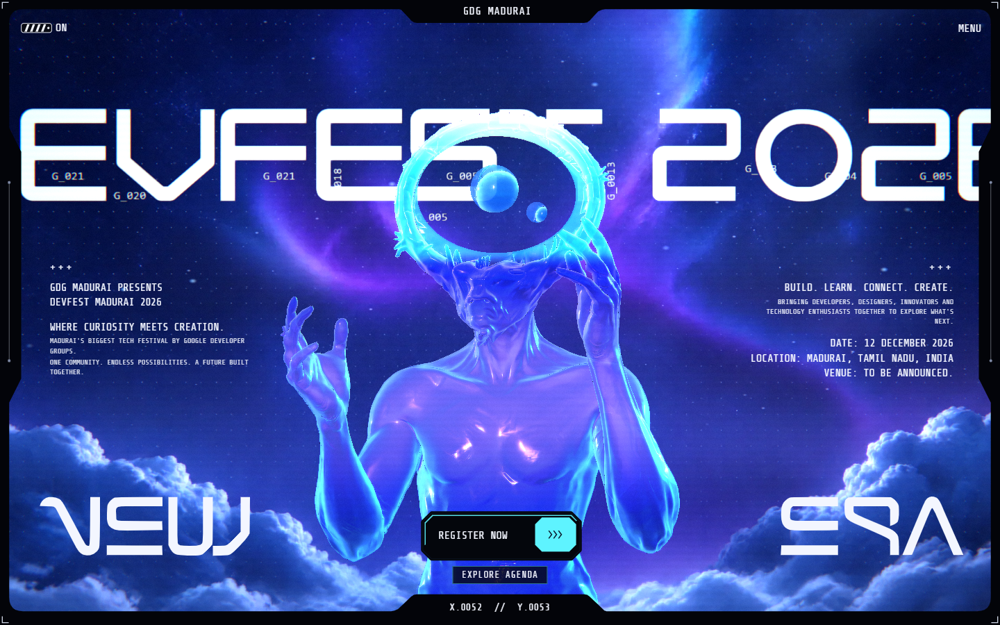
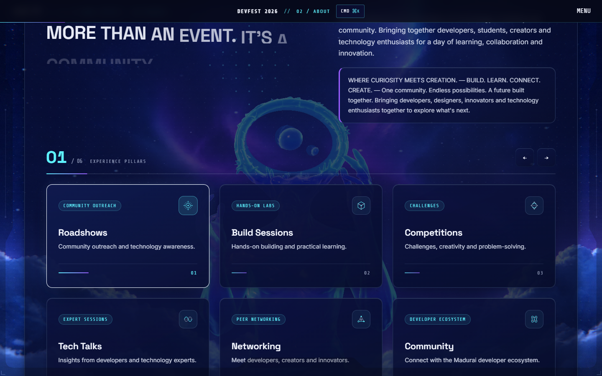
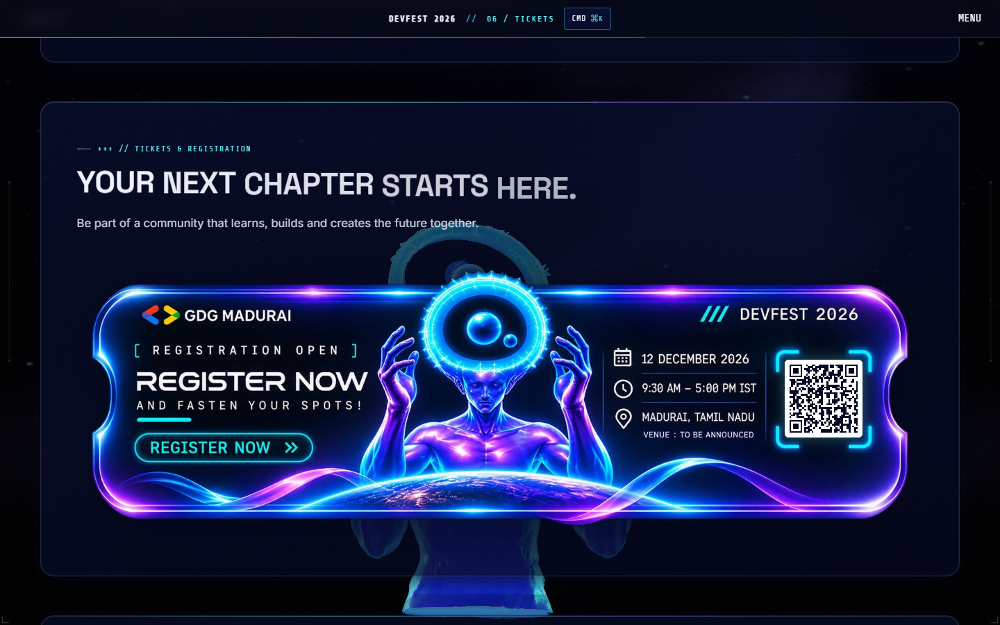
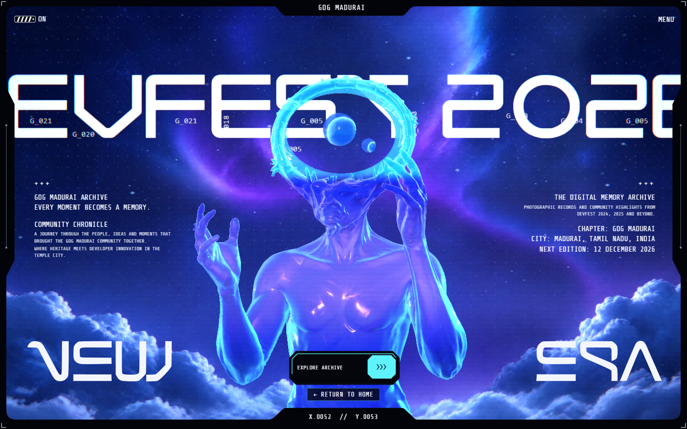

# GDG Madurai — DevFest 2026 Website

<div align="center">


### **Where curiosity meets creation.**

The official community website experience for **DevFest Madurai 2026**, bringing together developers, students, creators, and technology enthusiasts for South Tamil Nadu's flagship developer festival.

[](https://devmdu.vercel.app/)
[](./LICENSE)
[](https://vitejs.dev/)
[](https://threejs.org/)
[](https://greensock.com/gsap/)
[](https://lenis.darkroom.engineering/)

[**Explore Live Website**](https://devmdu.vercel.app/) · [**Register for DevFest 2026**](https://gdg.community.dev/events/details/google-gdg-madurai-presents-devfest-2026/) · [**Report a Bug**](https://github.com/Cyrilthetecchieee/DevFest-Madurai-2026/issues) · [**Contribute**](./CONTRIBUTING.md)

</div>

---

> [!NOTE]
> **Independent Community Event**: DevFest Madurai is an independent, community-run event organized by **GDG Madurai** under Google's Community Guidelines. It is not produced, managed, or officially owned by Google LLC.

---

## Website Previews

<div align="center">
  
</div>

<br />

| **Interactive Experience Pillars** | **Neon Registration & Scannable QR** |
|:---:|:---:|
|  |  |

| **Speakers Constellation & Roster** | **Memories Filmstrip & Community Archive** |
|:---:|:---:|
|  |  |

---

## Table of Contents

- [Event Overview](#event-overview)
- [Key Features](#key-features)
- [Design & Visual Direction](#design--visual-direction)
- [Tech Stack](#tech-stack)
- [Getting Started](#getting-started)
  - [Prerequisites](#prerequisites)
  - [Installation & Setup](#installation--setup)
  - [Available Scripts](#available-scripts)
- [Project Structure](#project-structure)
- [Configuration & Data Files](#configuration--data-files)
- [Design Locks & Contribution Rules](#design-locks--contribution-rules)
- [Contributing](#contributing)
- [License & Attribution](#license--attribution)
- [Community & Socials](#community--socials)
- [Acknowledgements](#acknowledgements)

---

## Event Overview

- **Event:** DevFest Madurai 2026
- **Tagline:** Where curiosity meets creation.
- **Pillars:** BUILD. LEARN. CONNECT. CREATE.
- **Date:** 12 December 2026 (Saturday · Full-day developer festival)
- **Time:** 9:30 AM – 5:00 PM IST
- **Location:** Madurai, Tamil Nadu, India
- **Venue:** Official venue to be announced soon
- **Registration Destination:** [Official GDG Community Event Page](https://gdg.community.dev/events/details/google-gdg-madurai-presents-devfest-2026/)

---

## Key Features

- **Cosmic WebGL Stage & Hero Experience:** High-performance Three.js canvas featuring an interactive 3D humanoid character, animated orbital rings, a procedural skyline, and a traced glyph marquee.
- **Unified Glassmorphism Interface:** Consistent midnight-blue translucent panels, controlled backdrop blurs, restrained cyan-violet edge highlights, and fine hairline borders.
- **Experience Pillars:** Six interactive glass pillar cards detailing Roadshows, Build Sessions, Competitions, Tech Talks, Networking, and Community.
- **Venue & Radar Telemetry:** Real-time countdown clock to 12 December 2026, coordinates display, and animated radar sweep visualization.
- **Interactive Speakers Constellation:** Speaker catalog with category filters (Keynote, AI/ML, Cloud & DevOps, Web & Mobile), view mode toggles (Constellation & Roster cards), and interactive detail sheets.
- **Self-Drawing Agenda Timeline:** Structured multi-track schedule with session detail cards, "My Day" bookmarking, and local `.ics` calendar file export.
- **Transparent Neon Registration Banner & Scannable QR:** High-resolution transparent neon badge showcase with an accessible `REGISTER NOW` CTA hotspot and an ISO/IEC 18004 scannable QR code verified across desktop, tablet, and mobile.
- **Memories Cinematic Archive:** Dedicated `/memories` multi-edition filmstrip celebrating past DevFest and GDG Madurai editions with full-screen lightbox viewing.
- **Mission Control HUD Chrome:** Pinned HUD with coordinate telemetry, dynamic dock waypoint tracking, keyboard shortcut palette (`Cmd + K`), and smooth SPA routing.
- **Zero Render-Blocking CSS:** Custom Vite build plugin that inlines critical CSS directly into production HTML outputs for instantaneous first-contentful paint.

---

## Design & Visual Direction

The visual identity combines cutting-edge futuristic interface aesthetics with South Indian cultural heritage:

- **Typography System:** Protected `Orbe Mono` technical numerals on the hero and HUD, paired with `Space Grotesk` (headings) and `Inter` (readable modern body typography) across all content sections.
- **Glassmorphic Tokens:** Layered midnight-blue surfaces (`#070a24` / `#0b1038`), soft inner shadows, and restrained dual-tone edge illumination (`#5ef3ff` cyan and `#9b5cff` violet).
- **Tamil Kolam Motifs:** Mathematical Tamil Kolam vector geometry woven into the loader, HUD telemetry, and mission badges.
- **Responsive Architecture:** Fully tested viewports from 360px mobile screens to ultra-wide displays without horizontal scroll overflow.

---

## Tech Stack

This project is built with vanilla modern JavaScript and Web APIs for performance:

| Category | Technology | Purpose |
|:---|:---|:---|
| **Core Framework** | Vanilla ES Modules (ES2022) | Zero-framework runtime overhead |
| **Bundler & Build Tool** | [Vite 8.3](https://vitejs.dev/) | Ultra-fast HMR, ES module bundling, clean route rewriting |
| **3D & Graphics** | [Three.js r187](https://threejs.org/) | WebGL stage, shaders, figure rendering, and particle canvas |
| **Animation Engine** | [GSAP 3.15](https://greensock.com/gsap/) | Timeline sequencing, scroll triggers, and SVG micro-interactions |
| **Smooth Scrolling** | [Lenis 1.3](https://lenis.darkroom.engineering/) | Hardware-accelerated inertial smooth scroll engine |
| **Testing & Verification** | [Playwright 1.65](https://playwright.dev/) | Cross-browser viewport verification & visual testing |
| **Image & Asset Pipeline** | [Sharp](https://sharp.pixelplumbing.com/) & [@gltf-transform](https://gltf-transform.dev/) | WebP/AVIF asset optimization and GLTF mesh compression |
| **Deployment & Hosting** | [Vercel](https://vercel.com/) | Edge routing, clean URLs, and global CDN caching |

---

## Getting Started

### Prerequisites

Ensure you have the following installed locally:
- **Node.js**: `v18.0.0` or higher (recommended: `v20.x` or `v22.x` LTS)
- **npm**: `v9.0.0` or higher (or `pnpm` / `yarn`)
- **Git**

Verify your versions:
```bash
node -v
npm -v
git --version
```

### Installation & Setup

1. **Clone the repository:**
   ```bash
   git clone https://github.com/Cyrilthetecchieee/DevFest-Madurai-2026.git
   cd DevFest-Madurai-2026
   ```

2. **Install dependencies:**
   ```bash
   npm install
   ```

3. **Start the local development server:**
   ```bash
   npm run dev
   ```
   Open your browser and navigate to `http://127.0.0.1:5173/` (or `http://localhost:5173/`).

### Available Scripts

| Command | Description |
|:---|:---|
| `npm run dev` | Starts Vite local development server with instant HMR |
| `npm run build` | Compiles production assets into `dist/` with CSS inlining |
| `npm run preview` | Previews the production build locally at `http://127.0.0.1:4173/` |

---

## Project Structure

```
DevFest-Madurai-2026/
├── docs/
│   └── screenshots/              # Visual captures of website sections for documentation
├── public/                       # Static public assets copied verbatim to build root
│   ├── assets/
│   │   ├── archive/              # Past edition photographs and community memories
│   │   ├── art/                  # Art direction backdrops and visual textures
│   │   ├── hero/                 # Pre-keyed posters and hero backplates (AVIF/WebP)
│   │   ├── models/               # Optimized 3D model assets
│   │   ├── partners/             # Community partner logos
│   │   ├── sponsors/             # Sponsor organization logos
│   │   └── tickets/              # Registration neon banner and scannable QR SVG/PNG
│   ├── fonts/                    # Self-hosted Orbe Mono and Orbe Mono Zero WOFF2 fonts
│   ├── apple-touch-icon.png      # 180x180 transparent GDG Madurai bracket icon
│   ├── favicon.ico               # Multi-resolution ICO (16x16, 32x32, 48x48)
│   ├── favicon-16x16.png         # 16x16 transparent PNG favicon
│   ├── favicon-32x32.png         # 32x32 transparent PNG favicon
│   ├── favicon-48x48.png         # 48x48 transparent PNG favicon
│   ├── manifest.webmanifest      # Progressive Web App manifest
│   ├── robots.txt                # Search engine crawler instructions
│   └── sitemap.xml               # XML sitemap for search indexation
├── src/                          # Application source code
│   ├── data/                     # Content JSON stores (Single Source of Truth)
│   │   ├── agenda.json           # Track schedules, sessions, and timing
│   │   ├── event.json            # Event metadata, pillars, links, and footer data
│   │   ├── memories.json         # Past edition memories and photo metadata
│   │   ├── speakers.json         # Speaker roster, designations, and topics
│   │   └── sponsors.json         # Sponsor tiers and partner information
│   ├── gl/                       # Three.js WebGL rendering pipeline
│   │   ├── cameraFlythrough.js   # Camera movement and scroll perspective
│   │   ├── figureRig.js          # 3D figure mesh, shaders, and material bindings
│   │   ├── marqueePlane.js       # WebGL marquee banner canvas projection
│   │   ├── particleDirector.js   # Atmospheric particle simulation
│   │   ├── postFx.js             # Post-processing bloom, tone-mapping, and grain
│   │   ├── skylineBuilder.js     # Procedural architectural horizon geometry
│   │   └── stage.js              # Three.js scene, renderer, and render loop
│   ├── motion/                   # Animation engines and timing tokens
│   │   ├── cursor.js             # Proximity-reactive custom cursor
│   │   ├── lenisTicker.js        # Lenis smooth-scroll ticker integration
│   │   ├── loader.js             # Mission Control introductory Kolam loader
│   │   └── tokens.js             # Easing curves, stagger delays, and scroll observers
│   ├── pages/                    # Route templates and SPA views
│   │   ├── home.js               # Landing page view orchestrator
│   │   ├── hud.js                # Mission Control persistent HUD dock & command palette
│   │   ├── memories.js           # Dedicated /memories page archive view
│   │   ├── router.js             # View Transitions client-side router
│   │   └── speakers.js           # Dedicated /speakers page roster view
│   ├── sections/                 # Modular page section components
│   │   ├── aboutSection.js       # About copy and 6 experience pillars
│   │   ├── agendaSection.js      # Timeline, session filters, and .ics export
│   │   ├── footerSection.js      # Monumental wordmark, legal bars, and social links
│   │   ├── memoriesFilmstrip.js  # Inertial filmstrip & swipeable modal lightbox
│   │   ├── speakersConstellation.js # Constellation node graph and speaker cards
│   │   ├── sponsorsSection.js    # Tiered sponsor grid and dual-speed marquee
│   │   ├── ticketsBadgeSection.js# Transparent registration banner & scannable QR
│   │   └── venueSection.js       # Radar telemetry, countdown, and venue cards
│   ├── styles/                   # Modular CSS stylesheets
│   │   ├── base.css              # Reset, typography rules, and utility classes
│   │   ├── hud.css               # HUD chrome, bezel SVGs, and dock styling
│   │   ├── sections.css          # Section glassmorphism and layout styling
│   │   └── tokens.css            # CSS custom properties, colors, and design tokens
│   ├── utils/                    # Shared helper utilities
│   │   ├── dom.js                # HTML escaping and DOM manipulation helpers
│   │   ├── env.js                # prefers-reduced-motion and device detection
│   │   └── quality.js            # Dynamic WebGL tiering based on device GPU
│   ├── visuals/                  # Procedural mathematical graphic generators
│   │   ├── gopuramBuilder.js     # Geometric temple gopuram outline synthesizer
│   │   └── kolamEngine.js        # Tamil Kolam pattern generator
│   └── main.js                   # Application entry point
├── .gitignore                    # Git untracked pattern definitions
├── CONTRIBUTING.md               # Detailed open-source contribution guidelines
├── CODE_OF_CONDUCT.md            # Contributor covenant & community code of conduct
├── LICENSE                       # ISC open-source license
├── index.html                    # Root landing page entry HTML
├── memories.html                 # Memories archive route HTML
├── speakers.html                 # Speakers directory route HTML
├── package.json                  # Project dependencies and npm scripts
├── vercel.json                   # Vercel deployment rewrites and caching headers
└── vite.config.js                # Vite build and plugin configuration
```

---

## Configuration & Data Files

The website is designed with a **content-driven architecture**. All event details, speakers, agenda timings, and social links are kept in JSON files under `src/data/`:

- `src/data/event.json`: Event date, location, registration URL, experience pillars, and social links.
- `src/data/speakers.json`: Speaker names, designations, companies, topics, and photo paths.
- `src/data/agenda.json`: Session timestamps, talk descriptions, tracks, and room assignments.
- `src/data/memories.json`: Historical photo paths, captions, and edition tags.

To update content, edit the corresponding JSON file without modifying component logic.

---

## Design Locks & Contribution Rules

To protect visual consistency and art direction, contributions must adhere to the following rules:

1. **Absolute Hero Lock:**
   - Do **not** modify hero typography, fonts, sizing, or positioning.
   - Do **not** modify the 3D humanoid character, orbital rings, or cosmic background plate.
   - Do **not** apply broad global CSS selectors that bleed into `#home` or `.hero-*`.

2. **Navbar & HUD Lock:**
   - Preserve the persistent HUD dock, command palette (`Cmd + K`), and navigation panel behavior.

3. **Glassmorphism System:**
   - Use translucent midnight-blue glass surfaces (`var(--glass-bg-card)`, `var(--glass-bg-surface)`).
   - Use restrained cyan (`#5ef3ff`) and violet (`#9b5cff`) hairline borders.
   - Avoid excessive opacity, high-contrast neon borders, or unoptimized blur filters.

4. **Typography Hierarchy:**
   - Headings & Titles: Modern bold sans-serif (`Space Grotesk`).
   - Body copy: Clean, readable sans-serif (`Inter`).
   - Technical metadata: Monospaced numerals (`Orbe Mono`).

5. **No Speculative Data:**
   - Maintain unconfirmed details (e.g. specific hall room numbers or unannounced speakers) as `TBA` or `To be announced`.

For the complete guide, please read [CONTRIBUTING.md](./CONTRIBUTING.md).

---

## How to Contribute

Contributions are welcome! Whether you are fixing a bug, improving the UI, enhancing animations, improving accessibility, or adding documentation, your contributions are appreciated.

### Step-by-Step Workflow

1. **Fork the repository** on GitHub.
2. **Clone your fork** locally:
   ```bash
   git clone https://github.com/<your-username>/DevFest-Madurai-2026.git
   cd DevFest-Madurai-2026
   ```
3. **Create a descriptive feature branch:**
   ```bash
   git checkout -b fix/agenda-accessibility-tags
   ```
4. **Install dependencies:**
   ```bash
   npm install
   ```
5. **Make your changes** while adhering to the design system and coding guidelines.
6. **Verify the production build:**
   ```bash
   npm run build
   ```
7. **Preview your build locally:**
   ```bash
   npm run preview
   ```
8. **Commit your changes** with a conventional commit message:
   ```bash
   git commit -m "fix(agenda): enhance screen reader labels for session bookmarks"
   ```
9. **Push to your fork:**
   ```bash
   git push origin fix/agenda-accessibility-tags
   ```
10. **Open a Pull Request** against the `main` branch of `Cyrilthetecchieee/DevFest-Madurai-2026`.

Please review our [Contributing Guidelines](./CONTRIBUTING.md) and [Code of Conduct](./CODE_OF_CONDUCT.md).

---

## License & Attribution

- **Source Code License:** This repository is open-sourced under the [ISC License](./LICENSE).
- **Trademarks & Branding:**
  - Google Developer Groups (GDG), DevFest, and associated Google marks are trademarks of Google LLC.
  - The GDG Madurai logo and bracket mark are community brand assets managed by GDG Madurai under Google Community Guidelines.
- **Third-Party Assets:**
  - Photographs displayed in the Memories Archive are the property of GDG Madurai and their respective community photographers.
  - Self-hosted fonts (`Orbe Mono`) and 3D mesh assets are utilized under their respective community distribution licenses.

---

## Community & Socials

Connect with the GDG Madurai community:

- **Official Community Page:** [gdg.community.dev/gdg-madurai](https://gdg.community.dev/gdg-madurai/)
- **X (Twitter):** [@gdgmadurai](https://x.com/gdgmadurai)
- **Instagram:** [@gdg_madurai](https://www.instagram.com/gdg_madurai/)
- **LinkedIn:** [company/gdg-madurai](https://www.linkedin.com/company/gdg-madurai/)
- **YouTube:** [@gdgmadurai](https://www.youtube.com/@gdgmadurai)
- **GitHub:** [github.com/Oenforge-Laboratory](https://github.com/Oenforge-Laboratory)
- **Email:** [contact@gdgmadurai.in](mailto:contact@gdgmadurai.in)

---

## Acknowledgements

Heartfelt thanks to:
- **GDG Madurai Organizers & Volunteers** for bringing DevFest to life in the Temple City.
- **Speakers, Mentors, and Community Builders** sharing knowledge with developers across South India.
- **Open-source maintainers** of Three.js, GSAP, Lenis, and Vite whose tools power this digital experience.
- Every developer who has contributed pull requests, issue reports, and feedback to this repository.

<div align="center">
  <sub>Built with curiosity and passion by the <b>GDG Madurai Community</b>.</sub>
</div>
